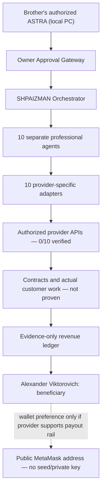

# SHPAIZMAN ORCHESTRATOR — Enterprise Brother Edition

**One orchestrator. Ten professional agents. One independent beneficiary. Evidence before actions.**

**Beneficiary:** Александр Викторович (Alexander Viktorovich). **Founder / initial architecture:** Alexander Romaskevich (RomaskevicH). This is a separately governed brother-edition project; no shared wallets, payouts, credentials or financial authority with IMPERIAL Core.

## What actually exists

- A **Python source installation kit 0.7.0 RC2** has been prepared separately from this repository; it contains a local orchestration runtime, 10 specialized agents, Windows installer scripts, local self-tests and a SQLite CRM.
- **This repository is the public verified handover and security contract.** It currently does **not** distribute the full Windows ZIP or a signed Windows EXE. The source ZIP must be supplied independently by its owner, and its SHA-256 independently compared.
- There are **10 defined platform adapters**, not 10 confirmed freelance marketplaces or paying employers. Authenticated accounts: **0/10 verified**. Automated revenue: **NOT VERIFIED**.
- The brother's own locally authorized ASTRA can follow the [handover protocol](docs/ASTRA_HANDOVER.md) and run the bounded preflight verifier **on his own Windows PC after permission**; merely connecting to GitHub does not grant remote desktop control.

## Enterprise architecture



The ZIP's local operations are testable without provider accounts; **external calls require account-specific approval, permitted APIs, and confirmed FREE_ONLY billing gates**. Providers are not automatically payment sources. See [Ten-Agent Registry](docs/AGENT_MATRIX.md).

## Technical handover for the brother's ASTRA

1. **Get the approved 0.7.0 RC2 ZIP and its `.sha256` file from the owner through an authorized transfer.** The ZIP is deliberately **not** embedded or uploaded in this GitHub repository.
2. Run `python -m enterprise.verify_release --zip-path PATH_TO_ZIP --expected-sha256 EXPECTED_64_HEX` (stdlib only, no code execution or extraction) on the **brother's machine**.
3. Read the output `enterprise/handover-contract.json`, [runbook](docs/ASTRA_HANDOVER.md), and the unpacked kit's `docs/ASTRA_ENTERPRISE_HANDOVER_RU.md`.
4. Install in a new per-user directory **only after the brother authorizes installation**. Run Windows tests, ten-agent offline smoke and platform-by-platform authorization. See [Acceptance](docs/ACCEPTANCE.md).

```bash
python -m unittest discover -s tests -v
python -m enterprise.verify_release --help
```

## Payout governance

**All legitimately earned, settled proceeds belong to the brother**, subject to contracts, taxes, provider rules and legal ownership. His public MetaMask address can be saved locally as a payout preference. A MetaMask address is **not a platform payout integration**, and many providers pay only through bank or other rails. This project never asks for recovery phrases, keys or wallet signatures, initiates transfers, guarantees returns or uses IMPERIAL Core funds. Invoice claims are **UNVERIFIED** until reconciled with a genuinely independent settlement source.

## Evidence / release status

| Gate | Status |
|---|---|
| Repository architecture, source ZIP review | INSPECTED |
| ZIP local unit suite (source candidate) | 127 tests completed, 0 failures, 1 skipped — Linux only |
| New repository verifier + CI | See exact PR and GitHub Actions results |
| Installation / Windows GUI on brother's machine | **NOT VERIFIED** |
| External platforms / API authentications | **0/10 VERIFIED** |
| Customer income, bank settlement, wallet receipt | **NOT VERIFIED** |
| Production autonomous jobs, external financial actions | **DENIED** |

**FREE_ONLY · Zero Trust · Deny by Default · Fail Closed · Brother Approval Required**

> A passing CI, screenshot or text-only documentation is not a certification of Windows desktop deployment or a guarantee of income.
