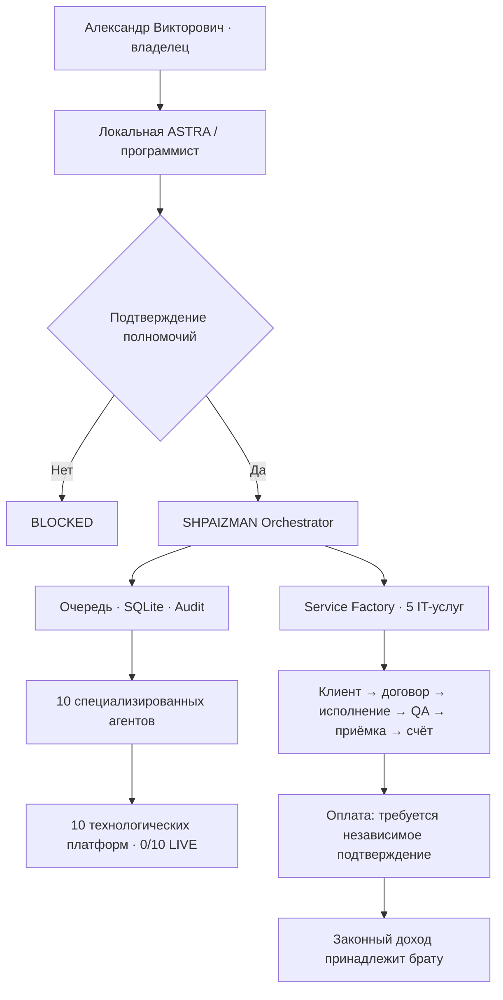

# SHPAIZMAN ORCHESTRATOR — Enterprise Brother Edition

**Один оркестратор · Десять профессиональных агентов · Собственный IT-бизнес Александра Викторовича**

[](https://github.com/oromaskevic23-cmd/SHPAIZMAN-ORCHESTRATOR/actions/workflows/enterprise-verification.yml)

> **Программисту брата: [ОТКРЫТЬ ПРЕЗЕНТАЦИЮ ПРОЕКТА](docs/PRESENTATION_RU.md) → [ПОШАГОВАЯ УСТАНОВКА НА WINDOWS](docs/WINDOWS_DEVELOPER_SETUP_RU.md) → [КОНТРОЛЬНАЯ СУММА ZIP](docs/RELEASE_0_8_0_RC1.md) → [АКТ ПРИЁМКИ](docs/PROGRAMMER_ACCEPTANCE_RU.md).**

**Версия отдельного Windows-пакета:** `SHPAIZMAN_SERVICE_FACTORY_0.8.0_RC1.zip` (Python source, **не EXE**).  
**SHA-256:** `9c26a398e585d9e1f79d75df71d3b99084b599cf5b832e0279dd857f94feb75e`.  
**GitHub:** здесь хранится публичный технический handover, исполняемое бизнес-ядро, ZIP-верификатор и CI. **Полный исходный Windows ZIP пока передаётся отдельно; в GitHub он не загружен.**

**Бенефициар и получатель законно полученных доходов:** Александр Викторович. **Автор исходного замысла:** Alexander Romaskevich — RomaskevicH. Кошельки, контракты, счета и клиентские данные брата отделены от IMPERIAL Core.

## Что получает брат

| Компонент | Реальное состояние | Код / инструкция |
|---|---|---|
| Центральный оркестратор, локальная SQLite CRM, GUI | Есть в исходном ZIP; Windows ПК брата не проверен | [Как получить ZIP](docs/RELEASE_0_8_0_RC1.md) · [Windows Setup](docs/WINDOWS_DEVELOPER_SETUP_RU.md) |
| 10 независимых профессиональных агентов | Локальный код имеется в ZIP; внешние аккаунты **0/10** | [Матрица агентов](docs/AGENT_MATRIX.md) |
| Service Factory — управление клиентскими IT-заказами | Рабочий офлайн-код в этом GitHub; доход не подтверждён | [Бизнес-ядро](shpaizman/business.py) · [CLI](shpaizman/business_cli.py) · [тесты](tests/test_business.py) |
| Проверка поставки перед установкой | Публичный read-only верификатор и тесты | [ZIP verifier](enterprise/verify_release.py) · [Enterprise CI](.github/workflows/enterprise-verification.yml) |
| Локальная ASTRA брата | Протокол передачи и границы полномочий; не подключена к его ПК | [ASTRA handover](docs/ASTRA_HANDOVER.md) · [контракт JSON](enterprise/handover-contract.json) |
| MetaMask / расчёты | Только публичный адрес при поддержке сети и согласии брата; никаких переводов | [Финансовая политика](docs/FINANCE_AND_PAYOUTS.md) |

## Как работает система



**Площадки — это инструменты выполнения заказов, не десять подтверждённых источников клиентов.** Настоящий IT-бизнес строится на законных заказах, понятных услугах, результатах и подтверждённой оплате.

## Быстрый старт для программиста

```powershell
# 1. Получить публичные инструкции и проверяющий код
git clone https://github.com/oromaskevic23-cmd/SHPAIZMAN-ORCHESTRATOR.git
cd SHPAIZMAN-ORCHESTRATOR

# 2. Получить ОТДЕЛЬНО у владельца полный ZIP версии 0.8.0 RC1
$SourceZip = Join-Path $env:USERPROFILE "Downloads\SHPAIZMAN_SERVICE_FACTORY_0.8.0_RC1.zip"

# 3. Проверить внешний SHA и внутренний список исходников до распаковки
py -3.12 -m enterprise.verify_release --zip-path "$SourceZip" --expected-sha256 "9c26a398e585d9e1f79d75df71d3b99084b599cf5b832e0279dd857f94feb75e"
```

После `SOURCE_ZIP_HASHES_VERIFIED_NO_CODE_EXECUTED` перейти к **[Windows Developer Setup](docs/WINDOWS_DEVELOPER_SETUP_RU.md)**: распаковать, запустить `INSTALL.cmd` только после согласия брата, затем `START_SHPAIZMAN.cmd`, `RUN_TESTS.cmd` и локальный smoke всех десяти агентов.

**Не запускайте `python run.py` из клона GitHub:** полного `run.py` в текущем дереве нет — он находится в отдельном ZIP.

## Инженерные материалы

[Техническая презентация](docs/PRESENTATION_RU.md) · [Система IT-заказов](docs/SERVICE_FACTORY.md) · [Передача в ASTRA](docs/ASTRA_HANDOVER.md) · [Безопасность](SECURITY.md) · [Акт приемки](docs/PROGRAMMER_ACCEPTANCE_RU.md) · [Реестр ZIP](docs/RELEASE_0_8_0_RC1.md)

## Текущая приёмка

- ZIP 0.8.0 RC1: SHA-256 сверяется с `9c26a398e585d9e1f79d75df71d3b99084b599cf5b832e0279dd857f94feb75e`, внутренний список 88 исходных файлов, всего 89 ZIP entries.
- Локальная Linux-проверка кандидата: **148 тестов, 0 ошибок, 1 пропуск** (из подготовленного пакета). Действительный CI текущего GitHub-кода смотрите в [Actions](https://github.com/oromaskevic23-cmd/SHPAIZMAN-ORCHESTRATOR/actions); цифры одного тестового окружения не равны приёмке Windows.
- **NOT VERIFIED:** установка на ПК брата, Windows GUI, 10 авторизованных внешних аккаунтов, Telegram-соединение, реальные клиенты и оплаченные заказы, подтверждённая выручка, вывод средств.
- **ZERO TRUST / FREE_ONLY / DENY BY DEFAULT / FAIL CLOSED:** никакой автоматической оплаты подписок, секретов MetaMask, скрытых переводов или прав на чужой компьютер.

**Публичный репозиторий сам по себе не получает доступ к ПК брата.** Он помогает программисту проверить и установить код с его разрешения.

**SHPAIZMAN: Build a real service. Verify every result.**
