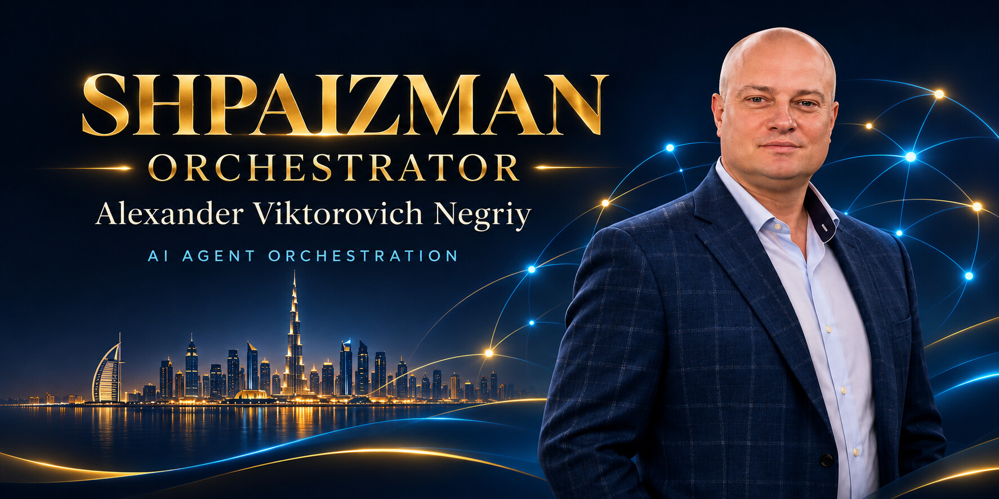
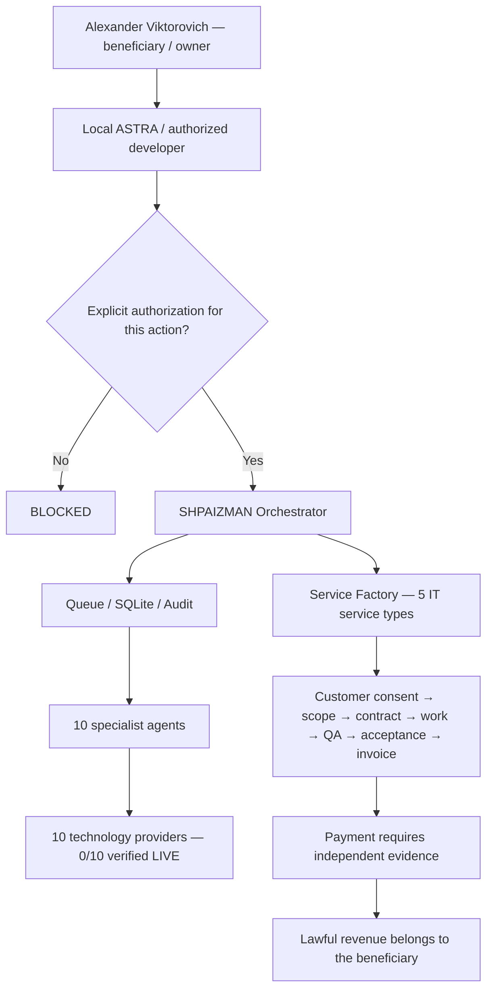

# SHPAIZMAN ORCHESTRATOR

## Install Brother Edition 0.9.1 on Windows

**[Download the Windows installation ZIP](https://github.com/oromaskevic23-cmd/SHPAIZMAN-ORCHESTRATOR/raw/refs/heads/main/downloads/SHPAIZMAN_Brother_Edition_0.9.1_Windows.zip)**. If you cloned the repository, the same file is in [downloads](downloads/SHPAIZMAN_Brother_Edition_0.9.1_Windows.zip). Use the scripts inside this ZIP for the brother's computer.

1. On Windows 10/11 x64, install Python 3.12 x64 with Tcl/Tk and the Python launcher. Download the ZIP, check its SHA-256 below, extract all files, and open `SHPAIZMAN_BROTHER_EDITION/START_HERE_RU.txt`.
2. Under the brother's Windows account, run **INSTALL.cmd** from the extracted folder. For an existing installation, first back up the CRM and close the previous version. The installer prints the new application path.
3. In the **installed folder**, open **START_SHPAIZMAN.cmd** and finish setup. For Telegram, close the application, create a dedicated bot with BotFather, then run **PAIR_TELEGRAM.cmd**. Enter the token at the hidden prompt. Send the displayed pairing command from the brother's phone and confirm his account ID at the computer.
4. Reopen **START_SHPAIZMAN.cmd**. Send `/status` to the bot. For natural-language tasks, start Ollama, run `ollama pull qwen2.5:1.5b`, and select that model under **SETTINGS > SAVE MODEL**. Run **CHECK_AI.cmd** for an end-to-end model check. Start the worker and send `/ask bitrix24 Suggest three fields for a repair ticket`. Send the returned `/result` command with its job ID.

Full Russian instructions are in the archive's **README.md**. The bot and desktop share the same local queue. Keep the computer awake and the application open while using Telegram.

~~~powershell
Get-FileHash .\SHPAIZMAN_Brother_Edition_0.9.1_Windows.zip -Algorithm SHA256
~~~

Expected SHA-256: `201f37d3b4bbe8cf40e85c04dc62a0b32c38a69d40c5baed18b8566d2fe8dfeb`.

The [original 0.9.0 gift ZIP](downloads/SHPAIZMAN_Brother_Edition_0.9.0_Windows.zip) is also preserved byte for byte. Version 0.9.1 corrects how a second Windows instance reports an already-open application.

<p align="center">
  
</p>

### AI orchestration for a service business

**Standalone source-checkout tools (separate from the packaged Brother Edition):** [Installation and acceptance guide](docs/CURRENT_DEVELOPER_HANDOVER.md). The current source includes a runnable CLI and desktop GUI; the historical 0.8.0 RC1 archive is not required for the new local AI runtime.

**Project owner and lead: Alexander Viktorovich Negriy.** [Project information and rights](AUTHORS.md).

SHPAIZMAN is an independent project for coordinating IT-service work. Its planned operating model combines a local orchestrator, ten specialist roles, a Windows workflow and controlled integrations. The repository contains an offline business core and a new executable local AI worker; actual model availability and external provider accounts require authorized local setup and verification.

**One local orchestrator · Ten professional agents · Independent IT service business for Alexander Viktorovich**

<p align="center">
  
</p>

### Contact Alexander Viktorovich Negriy

- **Email:** [yv.a83@mail.ru](mailto:yv.a83@mail.ru)
- **WhatsApp:** 89105969598
- **Telegram:** 89651312957 or 89651152957

The numbers are shown as supplied; international dialing and account availability have not been verified.

[](https://github.com/oromaskevic23-cmd/SHPAIZMAN-ORCHESTRATOR/actions/workflows/enterprise-verification.yml)

> **Historical 0.8.0 RC1 handover (not the current installation path):** [Project presentation](docs/PRESENTATION_RU.md) → [Step-by-step Windows setup](docs/WINDOWS_DEVELOPER_SETUP_RU.md) → [ZIP verification and checksum](docs/RELEASE_0_8_0_RC1.md) → [Acceptance checklist](docs/PROGRAMMER_ACCEPTANCE_RU.md).

**Standalone checkout Telegram adapter (read-only):** [secure pairing, token rotation and Windows setup](docs/TELEGRAM_OPERATOR.md). The public bot adapter reports local Service Factory status; it cannot run the ten agents or remotely access the beneficiary's computer.

**Historical separate Windows delivery:** `SHPAIZMAN_SERVICE_FACTORY_0.8.0_RC1.zip` (Python source code, **not an executable EXE**).
**Expected SHA-256:** `9c26a398e585d9e1f79d75df71d3b99084b599cf5b832e0279dd857f94feb75e`.
**Repository scope:** public engineering handover, executable local AI worker and offline business core, ZIP verifier and CI. The **full Windows source archive is provided separately and is not present in this GitHub repository**.

**Independent business beneficiary:** Alexander Viktorovich. His accounts, contracts, payment routes, wallets and customer data are separate from IMPERIAL Core.

## Deliverables and verified limits

| Component | Documented state | Source / instructions |
| --- | --- | --- |
| Local AI worker, SQLite queue and desktop GUI | Current source; live local model challenge passed on Linux; Windows PC installation NOT VERIFIED | [Current setup](docs/CURRENT_DEVELOPER_HANDOVER.md) · [Runtime](shpaizman/runtime.py) · [GUI](shpaizman/operator_ui.py) |
| Ten specialized local model roles | Implemented in current runtime; authorized external platform accounts: **0/10 verified** | [Agent matrix](docs/AGENT_MATRIX.md) |
| Service Factory IT order management | Offline repository code; actual paid income NOT VERIFIED | [Business engine](shpaizman/business.py) · [CLI](shpaizman/business_cli.py) · [tests](tests/test_business.py) |
| Package integrity verification | Read-only public ZIP verifier and tests | [Verifier](enterprise/verify_release.py) · [CI](.github/workflows/enterprise-verification.yml) |
| Beneficiary's local ASTRA | Handover boundaries specified; NOT connected to the Windows PC | [ASTRA handover](docs/ASTRA_HANDOVER.md) · [JSON contract](enterprise/handover-contract.json) |
| MetaMask / payouts | Public-address-only option on an approved supported network; no automatic transfers | [Finance policy](docs/FINANCE_AND_PAYOUTS.md) |

## Intended operating architecture



The ten platforms are **execution technologies, not ten proven customer marketplaces**. A real IT business depends on lawful clients, clear service delivery and independently verified payment.

## Working local AI runtime (new source implementation)

This is an executable local AI draft worker, not the previous synthetic demonstration. The ten existing agent identities are distinct local model roles, **not authenticated integrations with their named platforms**. The original Windows GUI archive remains separate. Project attribution and commercial beneficiary remain unchanged.

### Windows desktop operator (Python 3.12 x64)

After installing Python and Ollama and downloading the model, double-click `OPEN_SHPAIZMAN.cmd`. Choose one of the ten specialist roles, enter a real task, start the worker, and inspect the saved model output. Use STOP to prevent further processing. This UI is a new implementation; not the original archive GUI. Closing the window stops the shared queue. Keep the window open for continuous processing, or use the CLI worker separately. Do not run both controls concurrently.

Run `CHECK_LIVE_AI.cmd qwen2.5:3b` from a terminal to execute an actual local model challenge and obtain the response SHA-256. Nonzero exit means the check failed. This is a live local inference check, not certification of any external provider or ten independent model processes. The unit suite mocks inference and is a separate check. No model download or paid call happens automatically.

### Windows 10/11 (Python 3.12 x64)

Install Python 3.12 and Ollama on the beneficiary's authorized computer. Download a supported local model through Ollama (requires disk space, memory and internet for the initial download). Example model: `qwen2.5:3b`. Start Ollama locally. No cloud key is required; hardware and electricity costs still apply.

```powershell
ollama pull qwen2.5:3b
py -3.12 run.py status
py -3.12 run.py enable
py -3.12 run.py submit bitrix24 "Design a CRM field mapping for my authorized service project"
py -3.12 run.py serve --model qwen2.5:3b
```

Use another terminal for `py -3.12 run.py show JOB_ID` (substitute the returned ID) and `py -3.12 run.py stop`. On Windows, `START_SHPAIZMAN.cmd serve --model qwen2.5:3b` is an equivalent entry point. Close the worker with Ctrl+C. Restart the worker after a machine reboot; automatic Windows service installation is not included. The worker is idle while stopped, and in-flight output is fenced off. STOP does not physically interrupt a model request already in flight. Interrupted jobs are not automatically retried; submit a new job after reviewing the original.

The runtime sends tasks only to the fixed loopback Ollama endpoint. There is no fake response fallback. SQLite persists tasks and events; failed inference is recorded as FAILED and output is a draft for human review. Use only an authorized local Windows account and protect its data directory; the local operator commands are not cryptographic identity verification. Do not include credentials or unnecessary personal data in task text.

`py -3.12 -m unittest discover -s tests -v` runs unit checks; mocked model tests do not prove a live model works. Real inference on the beneficiary's hardware and external provider integrations are not yet verified. GUI execution on the actual Windows PC, automatic startup, Telegram write controls and production acceptance remain separate milestones.

## Offline demonstration (test fixture only)

Run the current repository's isolated, offline demonstration with synthetic data:

```bash
python -m shpaizman.demo
```

It demonstrates a stopped-by-default local queue, one reviewable draft, a stop switch, a fictional service order and integrity checks. It makes no AI or provider calls and records no real sale. See [competition demonstration and current gaps](docs/CHAMPIONSHIP.md).

Competition drafts: [English pitch deck](competition/SHPAIZMAN_Competition_Pitch.pptx) · [offline demo video](competition/SHPAIZMAN_Offline_Demo.mp4).

### Historical separate Windows package (not required for the current runtime)

```powershell
# 1. Clone the public engineering handover repository.
git clone https://github.com/oromaskevic23-cmd/SHPAIZMAN-ORCHESTRATOR.git
cd SHPAIZMAN-ORCHESTRATOR

# 2. Obtain the full, separate ZIP 0.8.0 RC1 from the owner.
$SourceZip = Join-Path $env:USERPROFILE "Downloads\SHPAIZMAN_SERVICE_FACTORY_0.8.0_RC1.zip"

# 3. Check the external SHA-256 and internal source manifest before extracting.
py -3.12 -m enterprise.verify_release --zip-path "$SourceZip" --expected-sha256 "9c26a398e585d9e1f79d75df71d3b99084b599cf5b832e0279dd857f94feb75e"
```

On `SOURCE_ZIP_HASHES_VERIFIED_NO_CODE_EXECUTED`, follow the [Windows developer setup](docs/WINDOWS_DEVELOPER_SETUP_RU.md). Extract/install only with the beneficiary's consent; then validate `INSTALL.cmd`, `START_SHPAIZMAN.cmd`, `RUN_TESTS.cmd`, SQLite persistence and all ten agents on the actual machine.

The new repository `run.py` launches the local AI worker described above; it does not restore the original ZIP's GUI or full orchestrator.

## Documentation

[Engineering presentation](docs/PRESENTATION_RU.md) · [Source map](docs/DEVELOPER_SOURCE_MAP_RU.md) · [ASTRA programmer brief](docs/ASTRA_PROGRAMMER_BRIEF_RU.md) · [Windows preflight](docs/PREFLIGHT_WINDOWS_RU.md) · [Service Factory](docs/SERVICE_FACTORY.md) · [ASTRA handover](docs/ASTRA_HANDOVER.md) · [Security](SECURITY.md) · [Acceptance](docs/PROGRAMMER_ACCEPTANCE_RU.md) · [ZIP register](docs/RELEASE_0_8_0_RC1.md)

Some document filenames retain their historical `_RU` suffix for link and tooling compatibility. **Their current Markdown content is maintained in English.**

## Evidence and limitations

- Repository tests: **66 passed on Linux and 66 on Windows** in [CI](https://github.com/oromaskevic23-cmd/SHPAIZMAN-ORCHESTRATOR/actions/runs/45426192354). The [actual local Ollama model challenge](https://github.com/oromaskevic23-cmd/SHPAIZMAN-ORCHESTRATOR/actions/runs/45426192565) passed on Linux. The beneficiary's own Windows installation remains unverified.
- Separate archive manifest: 88 source files checked by SHA-256, 89 ZIP entries including the manifest; expected outer ZIP SHA-256 is given above. The archive itself is not published here.
- Previously reported local Linux candidate tests: **148 tests, 0 failures, 1 skipped**. These are NOT results from the beneficiary's Windows PC; current repository CI results should be checked in [Actions](https://github.com/oromaskevic23-cmd/SHPAIZMAN-ORCHESTRATOR/actions).
- **NOT VERIFIED:** installation or GUI on the beneficiary's Windows PC; authorization for ten external platform accounts; Telegram connection; real clients, accepted paid orders, revenue or payouts; autonomous production operation.
- **ZERO TRUST / FREE_ONLY / DENY BY DEFAULT / FAIL CLOSED:** no automatically charged subscriptions, hidden transfer paths, wallet secrets, antivirus disablement or access to another person's machine without authorization.

A public GitHub clone does not grant remote access to the beneficiary's computer. All installation and platform connections require his explicit consent and local, authorized operation.

**SHPAIZMAN: Build a real service. Verify every result.**


## HARVEY-pattern local commercial planning — ten agents, no external connections

**New first-party offline upgrade:** [Engineering design / commands](docs/HARVEY_TEN_AGENT_UPGRADE.md) · [Queue and provider registry](shpaizman/harvey_bridge.py) · [Operator CLI](shpaizman/harvey_cli.py) · [Negative-path tests](tests/test_harvey_bridge.py).

All **ten original specialist agents** now have a separately bounded local prospect-review/solution-plan/offer-draft queue. An additional **21 technology candidates** mentioned in the Alice overview are classified as research-only and mapped to existing agents, **not** claimed as new connected agents or client marketplaces. The implementation adapts sales-agent workflow ideas from [Harvey (ethanplusai/harvey, MIT)](https://github.com/ethanplusai/harvey) without importing its source or accounts.

One offline draft per invoked cycle, local SQLite evidence, per-agent quotas, idempotency and manual stop are implemented; output requires explicit beneficiary review. **Not implemented:** automatic prospect search, third-party login/API integrations, outreach, always-on server agents, signed human approval or actual received revenue. External connections remain **0/10 independently verified**.

Run `python -m shpaizman.harvey_cli catalog` and `python -m shpaizman.harvey_cli status` on an authorized machine to inspect the safe local controls. The historical RC1 archive remains separate, and changes here do not install anything on Alexander Viktorovich's computer.
