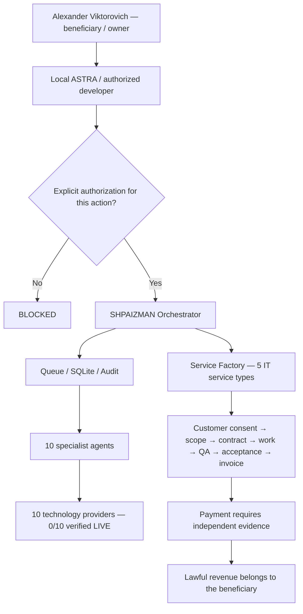

# SHPAIZMAN ORCHESTRATOR — Enterprise Brother Edition

**Project founder and founding architect:** Alexander Nikolaevich Romaskevich (RomaskevicH). [Authorship and contribution provenance](AUTHORS.md).

**One local orchestrator · Ten professional agents · Independent IT service business for Alexander Viktorovich**

<p align="center">
  
</p>

[](https://github.com/oromaskevic23-cmd/SHPAIZMAN-ORCHESTRATOR/actions/workflows/enterprise-verification.yml)

> **Developer handover:** [Project presentation](docs/PRESENTATION_RU.md) → [Step-by-step Windows setup](docs/WINDOWS_DEVELOPER_SETUP_RU.md) → [ZIP verification and checksum](docs/RELEASE_0_8_0_RC1.md) → [Acceptance checklist](docs/PROGRAMMER_ACCEPTANCE_RU.md).

**Telegram (read-only, not live until locally configured):** [secure pairing, token rotation and Windows setup](docs/TELEGRAM_OPERATOR.md). The public bot adapter reports local Service Factory status; it cannot run the ten agents or remotely access the beneficiary's computer.

**Separate Windows delivery:** `SHPAIZMAN_SERVICE_FACTORY_0.8.0_RC1.zip` (Python source code, **not an executable EXE**).  
**Expected SHA-256:** `9c26a398e585d9e1f79d75df71d3b99084b599cf5b832e0279dd857f94feb75e`.  
**Repository scope:** public engineering handover, executable offline business core, ZIP verifier and CI. The **full Windows source archive is provided separately and is not present in this GitHub repository**.

**Independent business beneficiary:** Alexander Viktorovich. **Original project architect:** Alexander Romaskevich (RomaskevicH). The beneficiary's accounts, contracts, payment routes, wallets and customer data are separate from IMPERIAL Core.

## Deliverables and verified limits

| Component | Documented state | Source / instructions |
| --- | --- | --- |
| Orchestrator, local SQLite CRM and GUI | Included in separately supplied ZIP; installation on beneficiary's Windows PC is NOT VERIFIED | [ZIP register](docs/RELEASE_0_8_0_RC1.md) · [Windows setup](docs/WINDOWS_DEVELOPER_SETUP_RU.md) |
| Ten specialized agent implementations | Described as present in the separate ZIP; authorized external platform accounts: **0/10 verified** | [Agent matrix](docs/AGENT_MATRIX.md) |
| Service Factory IT order management | Offline repository code; actual paid income NOT VERIFIED | [Business engine](shpaizman/business.py) · [CLI](shpaizman/business_cli.py) · [tests](tests/test_business.py) |
| Package integrity verification | Read-only public ZIP verifier and tests | [Verifier](enterprise/verify_release.py) · [CI](.github/workflows/enterprise-verification.yml) |
| Beneficiary's local ASTRA | Handover boundaries specified; NOT connected to the Windows PC | [ASTRA handover](docs/ASTRA_HANDOVER.md) · [JSON contract](enterprise/handover-contract.json) |
| MetaMask / payouts | Public-address-only option on an approved supported network; no automatic transfers | [Finance policy](docs/FINANCE_AND_PAYOUTS.md) |

## Intended operating architecture



The ten platforms are **execution technologies, not ten proven customer marketplaces**. A real IT business depends on lawful clients, clear service delivery and independently verified payment.

## Developer quick start

```powershell
# 1. Clone the public engineering handover repository.
git clone https://github.com/oromaskevic23-cmd/SHPAIZMAN-ORCHESTRATOR.git
cd SHPAIZMAN-ORCHESTRATOR

# 2. Obtain the full, separate ZIP 0.8.0 RC1 from the owner.
$SourceZip = Join-Path $env:USERPROFILE "Downloads\SHPAIZMAN_SERVICE_FACTORY_0.8.0_RC1.zip"

# 3. Check the external SHA-256 and internal source manifest before extracting.
py -3.12 -m enterprise.verify_release --zip-path "$SourceZip" --expected-sha256 "9c26a398e585d9e1f79d75df71d3b99084b599cf5b832e0279dd857f94feb75e"
```

On `SOURCE_ZIP_HASHES_VERIFIED_NO_CODE_EXECUTED`, follow the [Windows developer setup](docs/WINDOWS_DEVELOPER_SETUP_RU.md). Extract/install only with the beneficiary's consent; then validate `INSTALL.cmd`, `START_SHPAIZMAN.cmd`, `RUN_TESTS.cmd`, SQLite persistence and all ten agents on the actual machine.

**Do not run `python run.py` from this GitHub clone.** The full `run.py` is not in the current repository tree; it belongs to the separate ZIP.

## Documentation

[Engineering presentation](docs/PRESENTATION_RU.md) · [Source map](docs/DEVELOPER_SOURCE_MAP_RU.md) · [ASTRA programmer brief](docs/ASTRA_PROGRAMMER_BRIEF_RU.md) · [Windows preflight](docs/PREFLIGHT_WINDOWS_RU.md) · [Service Factory](docs/SERVICE_FACTORY.md) · [ASTRA handover](docs/ASTRA_HANDOVER.md) · [Security](SECURITY.md) · [Acceptance](docs/PROGRAMMER_ACCEPTANCE_RU.md) · [ZIP register](docs/RELEASE_0_8_0_RC1.md)

Some document filenames retain their historical `_RU` suffix for link and tooling compatibility. **Their current Markdown content is maintained in English.**

## Evidence and limitations

- Separate archive manifest: 88 source files checked by SHA-256, 89 ZIP entries including the manifest; expected outer ZIP SHA-256 is given above. The archive itself is not published here.
- Previously reported local Linux candidate tests: **148 tests, 0 failures, 1 skipped**. These are NOT results from the beneficiary's Windows PC; current repository CI results should be checked in [Actions](https://github.com/oromaskevic23-cmd/SHPAIZMAN-ORCHESTRATOR/actions).
- **NOT VERIFIED:** installation or GUI on the beneficiary's Windows PC; authorization for ten external platform accounts; Telegram connection; real clients, accepted paid orders, revenue or payouts; autonomous production operation.
- **ZERO TRUST / FREE_ONLY / DENY BY DEFAULT / FAIL CLOSED:** no automatically charged subscriptions, hidden transfer paths, wallet secrets, antivirus disablement or access to another person's machine without authorization.

A public GitHub clone does not grant remote access to the beneficiary's computer. All installation and platform connections require his explicit consent and local, authorized operation.

**SHPAIZMAN: Build a real service. Verify every result.**


---

### Canonical founder and public project identity

This public repository is listed in the [founder-maintained IMPERIAL Core engineering portfolio](https://oromaskevic23-cmd.github.io/oromaskevic23-cmd/projects/). The public [engineering source registry](https://oromaskevic23-cmd.github.io/Capital-Core-Public/reference/projects/) links this source to the account's published project records under **Alexander Nikolaevich Romaskevich (RomaskevicH)**, Founder, Owner and CEO of IMPERIAL Core and its final architectural decision authority. Repository-specific governance, contributor rights, third-party intellectual property, and documented independence of individual projects remain unchanged. Publication does not prove production execution, market adoption or Google indexing.
