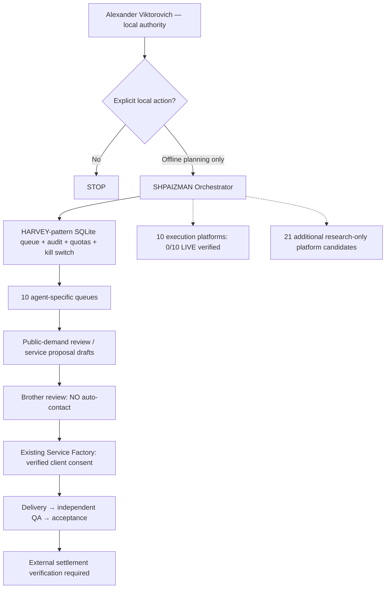

# SHPAIZMAN — HARVEY-pattern ten-agent enterprise upgrade

**Founding project architect:** Alexander Nikolaevich Romaskevich (RomaskevicH).  
**Independent beneficiary and local operating authority:** Alexander Viktorovich.  
**Implementation status:** first-party offline source and adversarial tests. **0/10 external providers authenticated; no live sales, automatic client discovery, messages, payments, or server deployment.**

## Origin and legal boundary

Design pattern reference: [ethanplusai/harvey](https://github.com/ethanplusai/harvey), MIT-licensed autonomous sales agent. This bridge is independently written; it does **not** install Harvey, borrow its source code, expose a Claude/Codex plan, or claim upstream endorsement. Review upstream licenses if copying any upstream code in future.

Keep ONE local SHPAIZMAN orchestrator and exactly TEN professional agents. The ten original identities are `albato`, `aimylogic`, `tomoru`, `twin`, `gigachat`, `yandex`, `nodul`, `bitrix24`, `mws`, `cloudru`. Each agent now has a separate local queue for prospect review, solution preparation and draft offers. The `ServiceFactory` service-to-agent map remains authoritative.

The **21 additional technology names from Alice's external overview** are registered as research-only candidates. They are enterprise/no-code/voice/customer-support platforms, a framework, and a potential standard; these are NOT verified sources of paying clients. They route into existing specialist agents and do not create new live connections.

## Architecture



## Verified implementation scope

- `shpaizman/harvey_bridge.py`: validated catalog, one agent per provider, enqueue with idempotency key, local SQLite persistence, bounded one-job cycle, 100 pending tasks per agent, 50 drafts per UTC day and manual persisted stop switch.
- `shpaizman/harvey_cli.py`: local commands `catalog`, `enqueue`, `resume`, `cycle`, `task`, `status`, `verify`, `pause`.
- Before processing and during verification, queued request fields are checked against their original local audit digest. This detects partial changes to the SQLite task record; an attacker who can rewrite the entire local database and chain is outside this check's protection.
- `tests/test_harvey_bridge.py`: isolation, all ten local agent cycles, idempotency conflict, bad URL rejection, kill switch, journal mutation and quota checks.
- All outputs are **deterministic local planning drafts** and service mappings. They do not search the internet, infer live clients, call LLMs or providers, send emails, submit proposals, initiate calls, transfer funds or produce verified revenue.
- Audit-chain hashes detect many accidental and partial changes, NOT a sufficiently privileged adversary rewriting the whole SQLite database. The CLI `resume` is an **unauthenticated local operator assertion**, not an enterprise identity system.

## Windows / Python 3.12 local reproduction

From the public repository root, with zero API keys:

```powershell
py -3.12 -m unittest discover -s tests -v
py -3.12 -m shpaizman.harvey_cli catalog
py -3.12 -m shpaizman.harvey_cli status
py -3.12 -m shpaizman.harvey_cli enqueue --agent albato --provider albato --task-type PROSPECT_REVIEW --title "Example public request for CRM automation" --source-url "https://example.com/opportunities/123" --event-key "local_opportunity_000001"
py -3.12 -m shpaizman.harvey_cli resume
py -3.12 -m shpaizman.harvey_cli cycle --agent albato
py -3.12 -m shpaizman.harvey_cli verify
py -3.12 -m shpaizman.harvey_cli pause
```

The example demand URL is **fictional**, never fetched. A genuine public URL must be reviewed for its source, Terms, privacy and contact rights before it can be used commercially. To prepare a draft about the GigaChain framework candidate, route to the existing `gigachat` agent (`--agent gigachat --provider gigachain`). The module starts stopped and runs only when invoked: **not an always-on worker**.

## Future production acceptance (NOT YET MET)

1. Verify the separately distributed complete Windows ZIP digest and beneficiary-authorized installation. This public repository does not contain the whole executable package.
2. Validate official documentation, credentials, permissions, geography, actual pricing, quotas and legal eligibility per required provider. Preserve FREE_ONLY, fail-closed default, no paid calls.
3. Integrate an authenticated beneficiary approval gateway. A simple CLI flag is not proof of identity or client permission.
4. Add narrow provider-specific connectors one at a time with mocks, tests and independently observed remote smoke checks.
5. Add approved demand feeds and consent-based outreach as a separate reviewed capability; forbid scraping policy circumvention and unsolicited mass messaging.
6. Use the separate Service Factory lifecycle for real delivery and independent QA. Never book proposed quotations, accepted offers or client statements as confirmed money without external settlement evidence.

**Independent brother-owned boundary:** no shared IMPERIAL Core credentials, CRM customer data, wallet keys, cloud runtimes or cross-project payment destinations. The original founder-level authorship record remains unchanged. No automatic wallet transfers.
