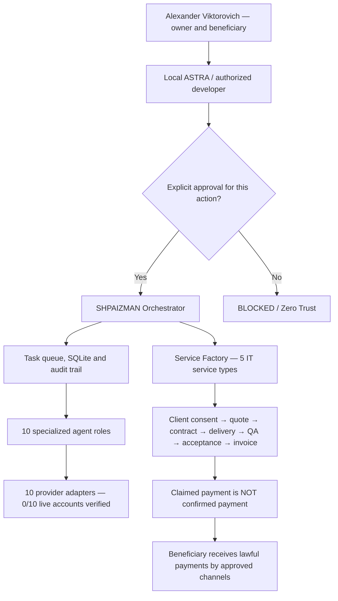

# SHPAIZMAN — Technical Presentation for the Developer

**Version:** SHPAIZMAN Service Factory 0.8.0 RC1. **Independent beneficiary:** Alexander Viktorovich. **Original architect:** RomaskevicH.

**Mission:** One local orchestrator coordinates technical work across ten specialized agents. The independent Service Factory handles legitimate customer IT service orders, from scope definition to independently verified payment evidence.

**Current evidence limit:** Python prototype, SQLite, Telegram integration requiring local configuration, and prior local tests. **NOT VERIFIED:** deployment on the beneficiary's PC, access to external providers, real orders, receipts or continuous autonomous production.

## Architecture in 60 seconds



## What is actually in the GitHub repository?

| Component | Purpose | Available source |
| --- | --- | --- |
| Business Engine | Offline SQLite-backed order pipeline and idempotency | [business.py](../shpaizman/business.py) |
| Business CLI | Commands to inspect offers, orders and records | [business_cli.py](../shpaizman/business_cli.py) |
| Read-only ZIP verification | Validate outer hash, members, paths and inner manifest without running ZIP code | [verify_release.py](../enterprise/verify_release.py) |
| ASTRA handover contract | Roles, ten provider identities and denied privileges | [handover-contract.json](../enterprise/handover-contract.json) |
| Offline tests | Malformed operation and tampered ZIP rejection | [tests](../tests) · [CI](../.github/workflows/enterprise-verification.yml) |
| Full GUI/orchestrator and ten adapters | **Not uploaded to this GitHub repository** | [Separate ZIP registry](RELEASE_0_8_0_RC1.md) |

**Developer notice:** This GitHub tree includes the offline business engine and handover instructions, not the complete Windows app. Never run `python run.py` from the GitHub clone: the full `run.py` must come from the separately obtained 0.8.0 RC1 ZIP.

## Installation and validation steps

1. **Obtain and check the package.** Read the [Windows guide](WINDOWS_DEVELOPER_SETUP_RU.md) and [release register](RELEASE_0_8_0_RC1.md). From the repository root, use the following read-only integrity command, substituting the actual trusted file path:

   ```powershell
   py -3.12 -m enterprise.verify_release --zip-path "C:\Path\SHPAIZMAN_SERVICE_FACTORY_0.8.0_RC1.zip" --expected-sha256 "9c26a398e585d9e1f79d75df71d3b99084b599cf5b832e0279dd857f94feb75e"
   ```

2. **Install only with beneficiary consent.** On Windows 10/11 x64, Python 3.12 x64 with Tkinter is required. From the verified extracted archive, execute `INSTALL.cmd` and then `START_SHPAIZMAN.cmd` under a standard user account. See [setup](WINDOWS_DEVELOPER_SETUP_RU.md).

3. **Test the ten agent sources and local core.** Check `RUN_TESTS.cmd`, local `run.py smoke` and `py -3.12 -m shpaizman.business_cli catalog`. Before external credentials are authorized, the demonstration is offline only.

4. **Connect third-party accounts individually.** Review the [agent matrix](AGENT_MATRIX.md) and [security policy](../SECURITY.md). Each provider requires its own legal account and current free-plan validation. TOMORU and MWS AI Agents must remain BLOCKED without an approved access path.

5. **Verify handover evidence.** Use the [acceptance record](PROGRAMMER_ACCEPTANCE_RU.md). Do not record `INSTALL=PASS` without logs from the beneficiary's real computer; do not record `EARNING=PASS` without external payment evidence.

## Security and financial boundaries

- The beneficiary alone controls receiving addresses and lawfully earned revenue; IMPERIAL Core is not the owner of these external accounts.
- MetaMask is a public receive-only address option on a supported chain, not an automatic cash register or customer acquisition tool. Never request seed phrases or private keys.
- Prohibited: silent administrator elevation, disabling Windows Defender, scanning unrelated accounts, unapproved paid calls, mass unsolicited messages or hidden transfers.
- On checksum mismatch, failing test, absent authorization or unavailable official provider API: **BLOCKED**, with evidence of the reason.

**Next engineering milestone:** verified target-Windows acceptance, one authorized provider connection at verified zero budget, one synthetic IT order and independently reviewed results. No earnings guarantee.
