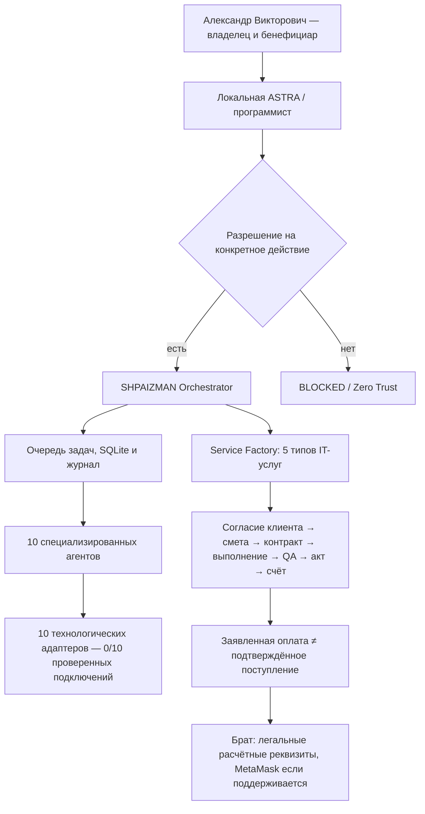

# SHPAIZMAN — инженерная презентация для программиста

**Версия поставки:** SHPAIZMAN Service Factory 0.8.0 RC1 · **Бенефициар:** Александр Викторович · **Автор архитектурного проекта:** RomaskevicH.

**Миссия:** один локальный оркестратор распределяет технические задания между десятью специализированными агентами; отдельное ядро Service Factory ведёт законные клиентские IT-заказы от заявки до предъявленного подтверждения расчёта.

**Текущий уровень:** исходный Python-прототип + SQLite + Telegram (после настройки) + локальные проверки. Не подтверждены фактическая установка на ПК брата, внешние аккаунты, получение заказов, поступление денег и промышленная автономность.

## За 60 секунд — архитектура

## Что находится в GitHub

| Компонент | Назначение | Исходники |
|---|---|---|
| Business Engine | Исполняемый конвейер заказов с SQLite, состояниями и идемпотентностью | [business.py](../shpaizman/business.py) |
| Business CLI | Проверяемые команды каталога, заказов и учёта | [business_cli.py](../shpaizman/business_cli.py) |
| Защитный верификатор ZIP | Проверка SHA-256, списка агентов, путей и манифеста без запуска файлов | [verify_release.py](../enterprise/verify_release.py) |
| Контракт ASTRA | Роли, 10 площадок и запретные полномочия | [handover-contract.json](../enterprise/handover-contract.json) |
| Автоматические тесты | Отказы при неправильных операциях и изменённом ZIP | [tests](../tests) · [CI](../.github/workflows/enterprise-verification.yml) |
| Полная GUI-программа, агенты и коннекторы | Python-комплект Windows, **ещё не опубликованный в самом GitHub** | [Как получить и проверить ZIP](RELEASE_0_8_0_RC1.md) |

**Примечание для разработчика:** у GitHub пока есть проверенное бизнес-ядро и безопасный handover, но не всё содержимое Windows ZIP. Не пытайтесь запускать `python run.py` из клона: полноценный `run.py` нужно брать из ZIP 0.8.0 RC1. Недостающие ссылки не изображаются рабочими.

## Начните здесь

<b>1. Скачать, сверить и безопасно распаковать</b>

Прочитайте [руководство установки](WINDOWS_DEVELOPER_SETUP_RU.md) и [протокол поставки](RELEASE_0_8_0_RC1.md). Для проверки действительного 0.8 ZIP используйте `python -m enterprise.verify_release --zip-path <путь> --expected-sha256 9c26a398e585d9e1f79d75df71d3b99084b599cf5b832e0279dd857f94feb75e` из корня GitHub-клона. Скрипт **ничего не выполняет** из ZIP.

<b>2. Установить на Windows — только с согласия брата</b>

Нужен Windows 10/11 x64 и Python 3.12 x64 с Tkinter. В папке распакованного ZIP выполните `INSTALL.cmd`, затем `START_SHPAIZMAN.cmd`. Запуск без административных прав. Подробнее — в [Windows Developer Setup](WINDOWS_DEVELOPER_SETUP_RU.md).

<b>3. Проверить десять агентов, оркестратор и бизнес-ядро</b>

`RUN_TESTS.cmd`, локальный `run.py smoke` и `py -3.12 -m shpaizman.business_cli catalog`. До подключения аккаунтов никакие внешние заказы или переводы средств не происходят.

<b>4. Подключать внешние сервисы по одному</b>

Учитывайте [10 технологических платформ](AGENT_MATRIX.md) и [шлюзы безопасности](../SECURITY.md). Для каждой требуется собственный разрешённый аккаунт, проверенные условия бесплатного доступа и одобрение брата. TOMORU и MWS AI Agents остаются заблокированы, пока нет проверенного метода доступа.

<b>5. Верифицировать результат передачи</b>

Проверять по [акту приёмки](PROGRAMMER_ACCEPTANCE_RU.md). Не выставлять INSTALL=PASS, пока нет журнала с реального компьютера; не выставлять EARNING=PASS, пока нет независимо подтверждённой оплаты.

## Права и безопасность

- **Кошелёк и 100% законно принадлежащей брату выручки** — только у Александра Викторовича; IMPERIAL Core не владеет его счетами и не получает выплаты.
- MetaMask — локальная настройка **публичного** адреса в разрешённой сети, а не источник заказов или автоматическая касса. Recovery phrase и приватные ключи не требуются.
- Запрещены автоматическая установка с повышением прав, выключение Windows Defender, сканирование чужих аккаунтов, платные вызовы без разрешения, массовая рассылка и скрытая отправка средств.
- При несовпадении хеша, неудачном тесте, отсутствии разрешения или отсутствии официального API — **BLOCKED**, с журналом причины.

**Следующий инженерный рубеж:** реальная Windows-приёмка, 1 разрешённое подключение с проверенным нулевым бюджетом, 1 демонстрационный IT-заказ и независимая проверка результатов. Не обещание дохода.
