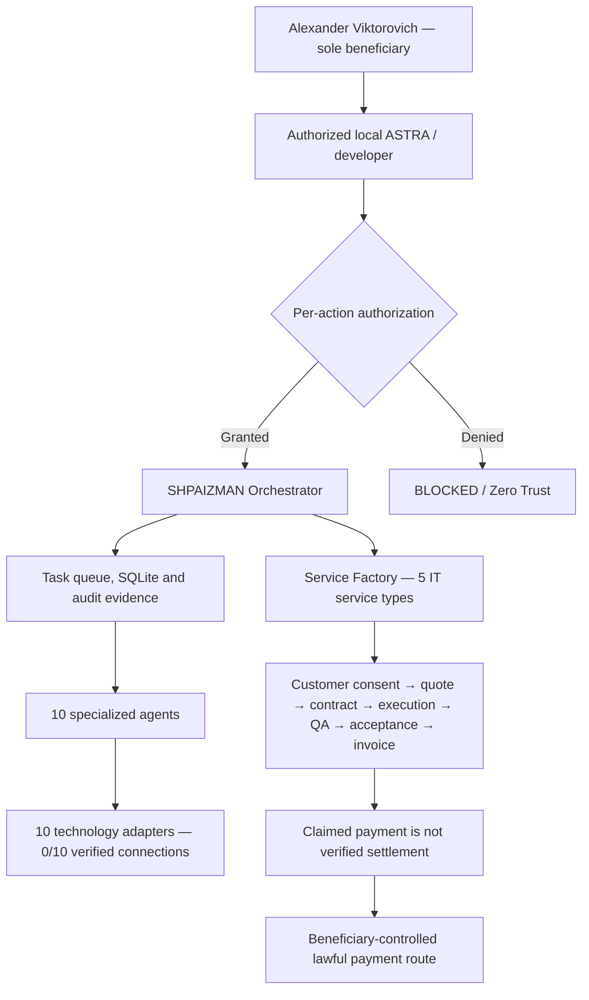

# SHPAIZMAN — engineering presentation for an authorized developer

**Delivery revision:** SHPAIZMAN Service Factory 0.8.0 RC1  
**Beneficiary:** Alexander Viktorovich  
**Project architecture:** Alexander Romaskevich (RomaskevicH)

**Mission:** one local orchestrator routes approved technical tasks to ten specialized agents; a separate Service Factory reference manages legitimate client IT orders from inquiry through independent payment evidence.

**Current truth:** Python source candidate, SQLite workflow, optional Telegram after setup, and local checks have been described. Actual installation on the beneficiary's computer, live third-party accounts, customer acquisition, payments and production autonomy are NOT VERIFIED.

## Architecture in 60 seconds

## What is actually in GitHub

| Component | Purpose | Source |
| --- | --- | --- |
| Business Engine | Offline order processing with SQLite, states and idempotence | [business.py](../shpaizman/business.py) |
| Business CLI | Inspectable commands for catalog, jobs and accounting | [business_cli.py](../shpaizman/business_cli.py) |
| Archive integrity verifier | Read-only SHA-256, path and agent manifest verification without executing ZIP contents | [verify_release.py](../enterprise/verify_release.py) |
| ASTRA handover contract | Ten provider adapters, rights and disallowed operations | [handover-contract.json](../enterprise/handover-contract.json) |
| Tests | Negative/adversarial checks and verification | [tests](../tests) · [CI](../.github/workflows/enterprise-verification.yml) |
| Complete Windows GUI/agent/connector source | **Not present in this GitHub repository** | [Separately provided ZIP](RELEASE_0_8_0_RC1.md) |

**Developer warning:** `python run.py` cannot be run from this public clone. The full application is only purportedly included in a separately delivered and independently verified ZIP. Do not misrepresent missing files as available.

## Recommended verified handover sequence

1. **Receive and verify.** Read the [Windows setup](WINDOWS_DEVELOPER_SETUP_RU.md) and [archive registry](RELEASE_0_8_0_RC1.md). Verify the separately supplied ZIP against its outer SHA-256 and internal manifest using the repository's read-only verifier. The verifier must not execute archive code.
2. **Install with consent.** On Windows 10/11 x64 with Python 3.12 x64/Tkinter, use the verified archive's `INSTALL.cmd` only with explicit approval and without administrator rights. See [Windows setup](WINDOWS_DEVELOPER_SETUP_RU.md).
3. **Verify components locally.** Run the verified bundle's `RUN_TESTS.cmd`, `run.py smoke` and `py -3.12 -m shpaizman.business_cli catalog`; confirm ten agents and safe STOP. Offline demonstration is not real customer fulfillment.
4. **Authorize providers separately.** Review the [ten-platform matrix](AGENT_MATRIX.md) and [security policy](../SECURITY.md). Only owner-authorized accounts with validated free plans are eligible. TOMORU and MWS AI Agents remain blocked without confirmed lawful/API access.
5. **Record actual results.** Complete the [Windows acceptance document](PROGRAMMER_ACCEPTANCE_RU.md). Do not mark INSTALL=PASS without actual target-machine logs or EARNING=PASS without independent payment evidence.

## Rights and safety

- **100% of legally earned beneficiary revenue** belongs to Alexander Viktorovich; IMPERIAL Core does not own his accounts or receive his payments.
- A MetaMask wallet, when supported and approved, is only a public receive-only address; never expose recovery phrases or private keys and never automate wallet transfers.
- No administrator escalation, antivirus disablement, unauthorized account access, unapproved paid APIs, mass messaging or concealed fund movement.
- On checksum mismatch, failed test, missing consent or unsupported provider API: **BLOCKED**, with an auditable reason.

**Next engineering milestone:** actual Windows acceptance, one separately authorized free-tier provider, one synthetic IT order and independent review. No promised income or ready-made corporation claim.
