# SHPAIZMAN Service Factory — independent IT business engine

**Beneficiary:** Alexander Viktorovich. **Architecture / original founder:** RomaskevicH.  
**Status:** implemented, offline customer-pipeline engine on this branch. **NO** authenticated external marketplaces, settled revenue, on-chain wallet delivery, remote PC control or autonomously contracted customers.

## The mechanism

The product is **not ten bots hoping ten websites will pay them**. It is an integrated customer delivery company: lawful demand → qualification → approved quote → actual services → QA → customer acceptance → invoice through an authorized service → independently reconciled financial settlement. The ten professional agents are a **production team**. Their named technology platforms (Albato, Aimylogic, TOMORU, TWIN, GigaChat, Yandex, Nodul, Bitrix24, MWS, Cloud.ru) are **tools**, not proven buyers or customer-acquisition marketplaces.

```mermaid
flowchart LR
 L["Consenting client request"] --> Q["Qualify scope and cost"]
 Q --> C["Brother-approved offer/contract"]
 C --> O["Service orchestration: authorized agents"]
 O --> T["Artifact / test / independent QA evidence"]
 T --> A["Customer acceptance"]
 A --> I["Invoice using authorized rails"]
 I --> P["Reported payment: UNVERIFIED"]
 P --> B["Independent bank/provider reconciliation: NOT IMPLEMENTED"]
 B -.-> W["Brother's legitimate settlement destination; MetaMask only if supported"]
```



### Five sellable, verifiable service packages

| Productized service | Orchestrated agent roles | Proposed acceptance output |
|---|---|---|
| **CRM Pipeline Setup** | Bitrix24, Albato | Field mappings, migration design, offline acceptance tests |
| **Customer Support Knowledge Assistant** | Aimylogic, GigaChat | Support intent catalog, privacy boundary, QA conversations |
| **Back-Office Workflow Automation** | Nodul, Albato | Workflow plan, rollback, deterministic test report |
| **Voice Support Prototype** | TOMORU, TWIN | Permission-aware call flow and offline script checks |
| **AI Operations Readiness Assessment** | Yandex, MWS, Cloud.ru | Architecture report, $0 budget guard, technical evaluation |

Pricing is **client-negotiated**. The software does not invent customer willingness to pay, recurring revenue or partnerships. Work involving third-party data, provider APIs or outbound messages is paused until the brother and client grant legitimate permission and fee-free access is confirmed.

## Implemented offline control system

The first-party source is [business.py](../shpaizman/business.py), with an [operator CLI](../shpaizman/business_cli.py), [negative-path tests](../tests/test_business.py) and zero-cost [GitHub Actions](../.github/workflows/enterprise-verification.yml).

```text
LEAD → QUALIFIED → PROPOSED → CLIENT_APPROVED → IN_PROGRESS
     → QA_PASSED → DELIVERED → CLIENT_ACCEPTED → INVOICED
     → SETTLEMENT_CLAIMED (NOT settled)
```

- Client contact requires an explicit *self-declared* consent flag. No extraction of personal data or unsolicited outreach.
- Order transitions cannot skip contract / execution / QA / acceptance / invoice stages. Sensitive actions also require a locally *asserted* brother confirmation; the CLI does not authenticate a real person.
- Every stage records a caller-supplied SHA-256 evidence reference, an idempotency key, transition stage and previous event hash. SQLite transactions keep the queue consistent; appended events have update/delete triggers. `verification()` recomputes the hash chain and projects expected order states.
- `SETTLEMENT_CLAIMED` means **an unverified external payment claim**. The dashboard intentionally reports **zero independently confirmed income**; quotes are never cash.
- No password capture, wallet signatures, seed phrases, paid calls, invoices sent, email outreach, banking actions, transfers or GitHub-to-Windows remote execution.

**Threat model:** A malicious process controlling the whole SQLite database can rewrite the event chain; local SHA-256 alone is not externally anchored evidence. A human CLI flag is not a signed authorization. True financial settlement requires bank/provider/accounting evidence verified out of band. Do not call the product revenue-generating until real customer jobs and reconciled proceeds exist.

## Reproduce — no paid services / no secrets

From the repository root, with Python 3.12+:

```bash
python -m unittest discover -s tests -v
python -m shpaizman.business_cli catalog
python -m shpaizman.business_cli --data-dir /tmp/shpaizman-local-demo dashboard
python -m shpaizman.business_cli --data-dir /tmp/shpaizman-local-demo verify
```

Windows data is under the brother's own `%LOCALAPPDATA%\SHPAIZMAN-BROTHER-EDITION` by default. The public GitHub repository supplies the first-party business engine and contract but **not** all ten executable adapters. The separate source ZIP must be delivered with SHA-256 and installed only with the brother's local approval.

### Example approved lead recording

```powershell
py -3.12 -m shpaizman.business_cli lead --customer-alias "Customer Example" --client-reference "CONSENT-000001" --service crm_pipeline --quote-minor 50000 --currency RUB --event-key "new_lead_00000001" --contact-consent-confirmed
```

This is a **record**, not an automatic message, offer or received payment. Event keys must be unique. To move stage, provide a separate SHA-256 of genuine evidence and locally acknowledge sensitive stages. Never enter real account passwords, wallet keys or identity documents in task fields.

## Actual income path (not yet live)

1. Prepare 3 safe portfolio demonstrations and a clearly scoped offer in Russian/English, with consent-compliant outreach only.
2. Find legitimate customer demand using official provider marketplaces/referrals, where account eligibility and regional payout rules allow. The existing ten SaaS platforms are not themselves prospect sources.
3. Brother approves a customer-specific proposal, delivery permissions, software licensing and fixed price; ASTRA routes offline production planning to the ten specialists.
4. Independently test the deliverable and obtain written acceptance; record client-approved invoice using the provider's genuine supported payment rail.
5. **Only after independently observed settlement** can external accounting confirm brother's revenue. MetaMask is an optional public crypto destination solely if the actual payer supports that token/network; no automatic conversion, wallet custody or transfer.

**Acceptance KPI proposal:** five qualified inquiries, three properly approved pilot offers, one genuinely accepted client delivery, one externally reconciled first payment; measure actual conversion, fulfillment quality and fees, not synthetic token balance.

**FREE_ONLY / Brother-owned / Zero Trust / Fail Closed.**
